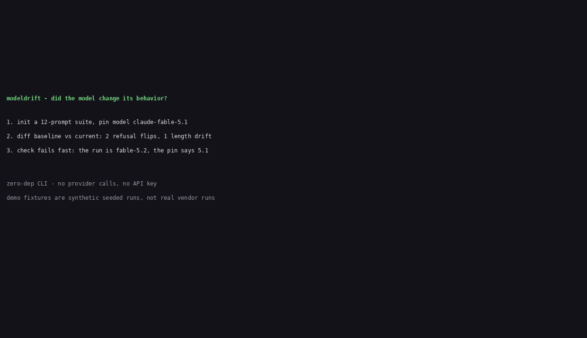

# modeldrift

Pin the model version, diff two recorded runs of the same prompts, and get a CI verdict - STABLE or DRIFT DETECTED - without calling any provider, without an API key, without a server.

Model vendors change behavior silently: a new version ships, a prompt that used to comply now refuses, an answer that used to be one paragraph is now five. modeldrift catches that drift by comparing runs you already recorded, with deterministic signals only. It never runs an eval, never calls a model, never judges quality - it reports that outputs differ, where, and how.

## Install (from source)

The npm package is not published yet. Install from source:

```sh
git clone https://github.com/techdevfun/modeldrift.git
cd modeldrift
npm install
npm run build
```

Then run it with `node dist/cli.js`, or link the binary once:

```sh
npm link   # makes `modeldrift` available on your PATH
```

Requires Node.js 20 or newer. Zero runtime dependencies.

## Quick start

```sh
# 1. Scaffold a prompt suite (12 prompts: refusal, format, reasoning, coding)
modeldrift init demo-suite

# 2. Record a baseline run of those prompts against your model (temperature 0,
#    fixed seed) as JSONL - one record per line:
#    {"id":"refuse-01","prompt":"...","model":"claude-fable-5.1","output":"...","temperature":0}

# 3. Pin the model + prompt set + baseline run
modeldrift pin --model claude-fable-5.1 --run baseline.jsonl

# 4. After a new model version ships, record the same prompts again and diff
modeldrift diff baseline.jsonl current.jsonl
# exit 0 = STABLE, 1 = DRIFT DETECTED, 2 = input error

# 5. Or verify the pin and diff in one step
modeldrift check --pin modeldrift.pin.json --run current.jsonl --baseline baseline.jsonl
# FAIL fast when the run's model does not match the pin:
# "model changed silently - expected claude-fable-5.1, got claude-fable-5.2"
```

## Commands

| Command | What it does |
| --- | --- |
| `modeldrift init [dir]` | Scaffold `prompts.json` (12 sample prompts), a pin template, and a short README. Refuses to overwrite unless `--force` is given. |
| `modeldrift diff <baseline.jsonl> <current.jsonl>` | Compare two recorded runs. `--format table\|json` (default `table`), `--threshold N` (changed-% that still counts as STABLE, default 0), `--length-threshold N` (length-ratio that counts as LENGTH-DRIFT, default 0.5). |
| `modeldrift pin --model <id> --run <file> [--out <file>]` | Write a pin: model id, sha256 of the prompt set, sha256 of the baseline run, creation time. |
| `modeldrift check --pin <pin> --run <file> [--baseline <file>]` | Verify the run's model and prompt set against the pin, then diff against the baseline when `--baseline` is given. |

## What a diff reports

Per prompt, one verdict:

| Verdict | Meaning |
| --- | --- |
| `IDENTICAL` | Output identical after whitespace normalization. |
| `CHANGED` | Output differs. |
| `REFUSAL-FLIP` | One side refuses, the other complies (see the phrase list below). |
| `LENGTH-DRIFT` | Length ratio exceeds the threshold (default 50%). |
| `STRUCTURE-FLIP` | JSON validity flips on a prompt that asks for JSON. |
| `NEW` / `REMOVED` | Prompt present on one side only. |

Summary: identical/changed %, refusal flips, median length delta, and the overall verdict `STABLE` or `DRIFT DETECTED`. When NEW + REMOVED prompts exceed 25% of the union, diff refuses with exit 2: the two runs are not the same prompt set.

Runs are JSONL, one record per line. Required fields: `id`, `prompt`, `output`. `model` is required at run level (on every record, or via `--model`). `temperature` is optional but recommended to be 0 - when a run records a temperature other than 0, diff prints a warning that changed % may include sampling noise.

## Refusal detection (heuristic, public list)

A refusal is detected by matching any of these phrases (case-insensitive):

> "I can't", "I cannot", "I'm unable to", "I am unable to", "I apologize, but I can't", "I apologize, but I cannot", "I'm sorry, but I can't", "I am sorry, but I cannot", "I'm sorry, but I am unable to", "I can't help with that", "I cannot help with that", "I'm not able to", "I am not able to", "I won't be able to", "I must decline", "I have to decline", "Sorry, I can't", "Sorry, I cannot", "I can't comply", "I cannot comply"

This is a heuristic, not ground truth. It can false-positive ("I can't believe how good this is") and false-negative (a polite sidestep that never says "can't"). modeldrift reports REFUSAL-FLIP as "one side refuses, the other does not, by this phrase list" - you decide what the flip means.

## Examples

`examples/` ships a 12-prompt suite (`prompts.json`) and two recorded runs:

- `fable-5.1-baseline.jsonl` - baseline run, model `claude-fable-5.1`
- `fable-5.2-current.jsonl` - current run, model `claude-fable-5.2`

```sh
modeldrift diff examples/fable-5.1-baseline.jsonl examples/fable-5.2-current.jsonl
# 12 prompts: 6 identical (50.0%), 6 changed (50.0%)
# refusal flips: 2, length drifts: 1, structure flips: 0, new: 0, removed: 0
# verdict: DRIFT DETECTED (exit 1)
```

**These fixtures are synthetic and seeded (seed 20261110), not real vendor runs.** The outputs are hand-written to show what a drift looks like. They prove nothing about any real model version. See `examples/README.md` for provenance.

## Where rivals beat us

- **promptfoo** runs evals live across providers, with LLM-as-judge rubrics, red-team drift detection, and a web UI for comparing runs. modeldrift only diffs runs you already recorded - it does not run evals, does not judge quality, and has no UI.
- **claude-drift** replays real Claude Code sessions on a new model and separates drift from noise with self-replays. modeldrift does not replay anything and does not measure a noise band; if your runs were recorded at temperature above 0, changed % will mix sampling noise into real drift.
- **Langfuse / DeepEval / lm-eval-harness** cover tracing, RAG quality metrics, and standard eval suites. modeldrift is a narrower layer: run-vs-run behavior diff plus a model pin, for teams that already record their evals and want a one-command CI gate on top.

## Honest limits

- **Sampling noise:** at temperature above 0, the same model gives different outputs on repeated runs. Record at temperature 0 with a fixed seed, or expect changed % to include noise. modeldrift warns when a run records temperature other than 0.
- **Refusal heuristic:** the phrase list is a rough detector (see above). A flip is a signal to read the diff, not a verdict about the model.
- **Same-version silent weight changes:** a pin catches a changed version string. If a vendor changes weights under the same version string, only the output diff can catch it - that is exactly what diff is for, but a small change may stay under your threshold.
- **No quality judgment:** modeldrift reports that outputs differ, never whether the new output is better or worse. "Better or worse" is the reader's job.

## Demo



The demo runs the real CLI: `init`, `pin` (fable-5.1), `diff` of the synthetic seeded fixtures (DRIFT DETECTED, exit 1), and `check` against a run recorded as fable-5.2 (FAIL: model mismatch). Transcript: `demo/transcript.txt`.

## Development

```sh
npm run build    # tsc, strict
npm test         # unit + e2e (node --test, explicit file list)
npm run test:live  # live smoke: name checks, soft-skips offline
npm run preflight  # Rule 7 scan: ASCII-only + no internal names
```

## Roadmap

- `--json` diff output already supported; add `--format csv` for spreadsheets.
- Optional `--baseline` discovery from the pin file itself.
- Publish to npm once a registry token is available (install-from-source until then).
- A `--noise-band` mode: diff two runs of the same model to measure sampling noise before judging drift.

## License

MIT - see [LICENSE](LICENSE).
